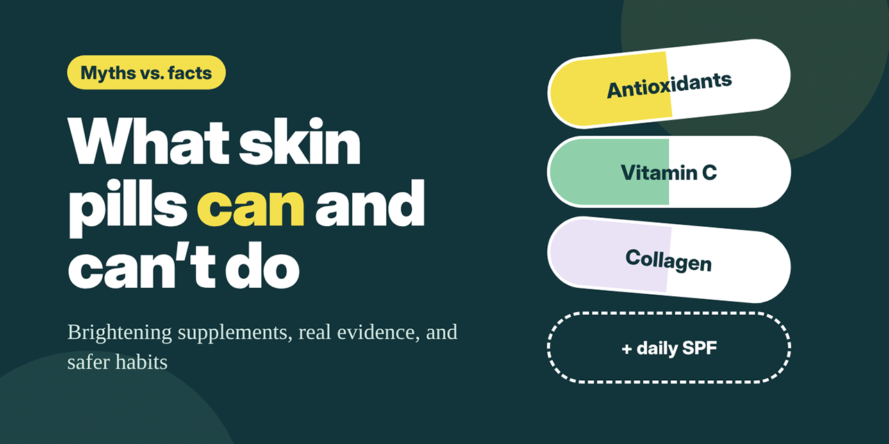

# Supplement Claim Linter

A small, dependency-free JavaScript tool that flags overpromising phrases in skin brightening supplement copy and explains why each one is a problem.

**Live demo:** https://nubestimmunegummies.github.io/supplement-claim-linter/



## What it does

Paste marketing copy into the text box. The linter:

- Highlights phrases that overpromise, color-coded by severity
- Explains why each phrase is flagged, in plain language
- Suggests a more realistic alternative

Example input (fictional ad copy):

> Get permanently brighter skin in 7 days! Our FDA-approved formula works instantly, so you can skip sunscreen. Guaranteed results or your money back.

Flagged: `permanently`, `in 7 days`, `FDA-approved`, `instantly`, `skip sunscreen`, `Guaranteed results`.

## Rules

| Rule | Severity | Example matches | Why it's flagged |
|---|---|---|---|
| `permanent` | High | permanent, permanently | Natural skin tone is largely genetic; supplements don't permanently change it. |
| `too-fast` | High | instantly, overnight, in 7 days | Studies on oral glutathione typically measure results at 8 to 12 weeks. |
| `fda-approved` | High | FDA-approved, FDA approved | The FDA doesn't approve dietary supplements before they're sold. |
| `skip-spf` | Medium | skip sunscreen, replace SPF | No supplement replaces daily sun protection. |
| `guaranteed` | Medium | guaranteed results | Individual results vary with genetics, age, and routine. |

Rules live as plain objects at the top of `script.js`, so you can add, edit, or remove them without touching the logic.

## How it works

1. **Rules as data.** Each rule has an `id`, `severity`, a regex `pattern`, a `note`, and a `suggestion`.
2. **`matchAll` with a guaranteed `g` flag.** `matchAll` throws without the global flag, so `withGlobalFlag()` adds it automatically and creates a fresh `RegExp` to avoid stateful `lastIndex` bugs.
3. **Overlap handling.** `toSegments()` is a pure function that splits text into plain and flagged pieces, skipping any match that starts inside an earlier one.
4. **Safe rendering.** Output is built with `textContent` and a `DocumentFragment`, never `innerHTML`, so pasted markup is always treated as plain text.
5. **Debounced input.** The linter re-runs 150 ms after typing stops.

## Run locally

No build step. Clone the repo and open `index.html` in a browser:

```bash
git clone https://github.com/nubestimmunegummies/supplement-claim-linter.git
cd supplement-claim-linter
open index.html        # macOS; on Windows use: start index.html
```

The core functions are also exported for Node, so you can test them directly:

```bash
node -e "const { lint } = require('./script.js'); console.log(lint('Results overnight!'))"
```

## Project structure

```
supplement-claim-linter/
├── index.html      # Page layout and explainer
├── style.css       # Styles (light and dark mode)
├── script.js       # Rules, linter logic, and rendering
├── README.md
└── assets/
    └── cover.png   # Social preview and README image (1280×640)
```

## Background

The rules are based on common myths covered in [Debunk Top Myths About Pills That Lighten Skin](https://www.nubest.com/blogs/beauty-care/pills-that-lighten-skin) by the NuBest editorial team. Regulations and evidence change over time, so review the rule set against current sources before relying on it.

## Disclosure

The author works with NuBest Nutrition, whose article is cited as background for the rules. This project is a text-processing demo. It is not health, medical, or legal advice.
